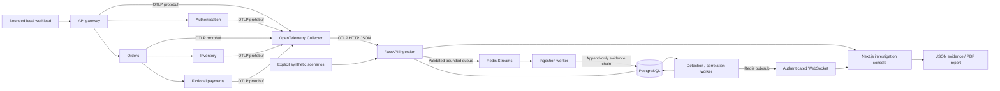

# TRACEFORGE

**Cybersecurity Flight Recorder and Incident Reconstruction Platform**

TraceForge collects telemetry from five local demonstration services, evaluates explainable security rules, and lets an analyst reconstruct an incident from its recorded evidence. It is a defensive engineering portfolio project. Payments are fictional, workloads are bounded, and no external targets are accepted.

## Why this exists

An alert rarely explains an incident. Authentication logs, HTTP errors, trace spans, and service metrics often arrive separately, with incomplete identifiers. TraceForge preserves those gaps and connects only evidence supported by explicit identifiers and configured windows. Its Security Time Machine replays the resulting timeline without modifying source events.

## Architecture



## Run locally

Prerequisites: Docker Engine with Compose v2; on Windows, Docker Desktop with its Linux-container backend enabled. No paid API is required.

```powershell
git clone https://github.com/jeelthacker1/traceforge.git
cd traceforge
pwsh -File scripts/configure.ps1
docker compose up --build
```

On Linux/macOS, create `.env` without overwriting an existing configuration:

```sh
python scripts/configure.py
docker compose up --build
```

Open [the dashboard](http://localhost:3000). Sign in as `admin` using `ADMIN_PASSWORD` from your local `.env`. The setup scripts generate independent random secrets and never print them. `.env` is ignored by Git. The initial configuration step is required so there is no shared default administrator password.

Generate actual local traffic:

```sh
docker compose run --rm workload python workload.py --count 60
docker compose run --rm workload python workload.py --count 12 --failures
```

The first command exercises browsing, authentication, orders, inventory, and simulated payments. The second emits real authentication audit telemetry for controlled local login failures. The Scenario lab separately creates reproducible, explicitly synthetic evidence.

## Investigation workflow

1. Inspect event volume, latency, authentication failures, and pipeline health.
2. Open the service graph. Edges require observed parent-child spans; absent parents are reported as gaps.
3. Run scenario A, B, C, or D and wait for the background workers to produce detections.
4. Open an incident, move through its timeline, inspect evidence, compare the preceding baseline, and record notes or bookmarks.
5. Verify the chain and export JSON evidence or a PDF report.

The JSON export contains the complete normalized evidence chain, not just incident events, so offline continuity checks are possible. Export access is organization-wide in this single-workspace application.

```sh
python scripts/verify_export.py incident.json
# Stronger check: retain the checkpoint separately; supply its signing key via environment.
python scripts/verify_export.py incident.json --checkpoint trusted-checkpoint.json
```

## Detection logic

| Rule | Default condition | Important limitation |
| --- | --- | --- |
| Login failures | 5 failures for an account/service in 60 seconds | Recovery attempts can be legitimate |
| Password spray | 5 distinct failed accounts from one source in 60 seconds | Shared sources can combine unrelated users |
| Privileged access | 3 explicitly unauthorized administrative requests in 60 seconds | Missing authorization is unknown |
| Error spike | ≥50% errors and ≥30 percentage-point increase over prior baseline | Operational failures do not establish malicious activity |
| Request frequency | 120 requests/source/service in 60 seconds | Legitimate concentrated traffic can trigger an indicator |
| Unexpected dependency | Parent-child service edge outside the configured baseline | New legitimate dependencies need baseline updates |

Rules expose required fields, thresholds, windows, severity, evidence IDs, limitations, and suppression controls. Alert acknowledgment, assignment, escalation, resolution, incident status changes, notes, and audit records persist in PostgreSQL.

Statistical analysis uses the preceding observations as training data and holds out the newest observation. Rolling mean, sample standard deviation, EWMA, and Z-score are available. Cold starts and zero variance produce an explicit unavailable score. Isolation Forest is intentionally optional and is not enabled.

## Repository map

- `backend/app/`: API, RBAC, normalization, rules, correlation, analytics, evidence integrity.
- `backend/demo.py`: five instrumented service roles from one shared image.
- `backend/migrations/`: Alembic schema bootstrap.
- `web/`: strict TypeScript Next.js App Router dashboard, Tailwind, shadcn-style UI primitives, React Flow, Recharts, Zustand.
- `infra/`: OpenTelemetry Collector configuration.
- `scripts/`: secure setup, offline evidence verification, isolated-host validation.
- `.github/workflows/ci.yml`: backend, frontend, and full Docker/Playwright verification.

## Verification and benchmarks

See [TESTING.md](TESTING.md) for the exact verification status and [PLAN.md](PLAN.md) for implementation status. Benchmark results are recorded only after execution. Run the 10,000-event persistence benchmark with:

```sh
cd backend
python -m pip install -r requirements.txt
python -m pytest -q
python -m ruff check .
python benchmark.py
```

The benchmark measures local SQLite persistence, hash verification, server graph construction, scenario processing, and incident queries. It is not a claim about distributed ingestion capacity or browser rendering performance. GitHub Actions uploads measured results as an artifact.

## Screenshots

Screenshots are added only when captured from a running application. See the verification record for whether browser capture was available; no mock image is presented as a live dashboard.

## Security boundaries and limitations

- Loopback-only published ports; internal database, Redis, Collector, and demo services have no host ports.
- Argon2id password hashes; opaque, hashed, expiring HttpOnly session cookies; ADMIN, SECURITY_ANALYST, VIEWER authorization; WebSocket origin/session checks.
- Ingestion requires a separate credential. Origin labels describe source-supplied provenance; trusted ingestion credentials can still submit false telemetry.
- Sensitive structured fields are redacted before hashing; arbitrary sensitive free text cannot be reliably recognized. Do not submit real passwords or personal data.
- Hash chains are **tamper-evident**, not tamper-proof. An administrator can rewrite events and hashes. Separately retained HMAC checkpoints improve detection only if their key and storage are protected independently.
- This is one shared analyst workspace, not a multi-tenant product. VIEWER can read all workspace telemetry and reports.
- Local HTTP cookies are configured for loopback development. Public deployment requires TLS, `COOKIE_SECURE=true`, an exact origin allowlist, protected internal networking, and secret rotation.
- Retention is conservative: policy inspection and explicit archive workflow preserve evidence; silent deletion is not performed. See [SECURITY.md](SECURITY.md).
- Detection evaluation favors explainability over high-scale optimization. Queries are capped and report truncation where applicable.

## Roadmap

Partitioned evidence-chain epochs and automated retention; external asymmetric checkpoint signing; durable report jobs; multi-tenant isolation; SSO/MFA; streaming window indexes; calibrated optional Isolation Forest; deployment-change integrations; notification connectors; browser and distributed throughput benchmarks.

Read [DEMO.md](DEMO.md) for a three-minute walkthrough, [ARCHITECTURE.md](ARCHITECTURE.md) for design decisions, and [SECURITY.md](SECURITY.md) for the threat model.
